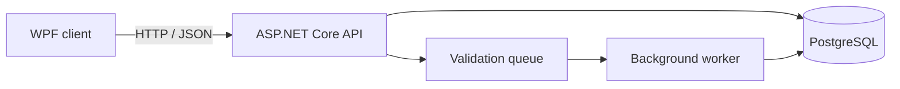

# ModelOps

An application for checking engineering model data. The desktop client sends requests to an ASP.NET Core API, PostgreSQL stores model elements and validation results, and long-running checks are handled in the background.

The repository works with synthetic data and contains no project files or proprietary integrations.

## Architecture



The solution is split by responsibility:

- `ModelOps.Domain` — entities and domain enums;
- `ModelOps.Application` — API contracts and validation rules;
- `ModelOps.Infrastructure` — EF Core and PostgreSQL mapping;
- `ModelOps.Api` — endpoints, queue and background worker;
- `ModelOps.Desktop` — WPF client;
- `ModelOps.UnitTests` — validation rule tests.

## Run locally

Requirements: Docker Desktop and .NET 10 SDK on Windows.

Start PostgreSQL and the API:

```powershell
docker compose up --build
```

Run the desktop client in a second terminal:

```powershell
dotnet run --project src/ModelOps.Desktop/ModelOps.Desktop.csproj
```

In the application:

1. Select **Load projects**.
2. Create a project.
3. Generate 10,000 elements.
4. Start the validation.
5. Watch the progress and inspect the issues.

OpenAPI is available at `http://localhost:5080/openapi/v1.json`. Example requests are in `ModelOps.Api.http`.

To run the API outside Docker, start only PostgreSQL:

```powershell
docker compose up postgres
dotnet run --project src/ModelOps.Api/ModelOps.Api.csproj --launch-profile http
```

The fallback connection string is for local development only:

```text
Host=localhost;Port=5432;Database=modelops;Username=modelops;Password=modelops
```

For another environment, pass `ConnectionStrings__Postgres` through configuration.

## API

| Method | Route | Purpose |
|---|---|---|
| `GET` | `/health` | Checks API and PostgreSQL availability |
| `POST` | `/api/v1/projects` | Creates a model project |
| `GET` | `/api/v1/projects` | Lists projects with element counts |
| `POST` | `/api/v1/projects/{id}/generate` | Generates 1–50,000 model elements in batches |
| `GET` | `/api/v1/projects/{id}/elements` | Searches and paginates model elements |
| `POST` | `/api/v1/projects/{id}/checks` | Queues validation and returns `202 Accepted` |
| `GET` | `/api/v1/checks/{id}` | Returns progress and totals |
| `GET` | `/api/v1/checks/{id}/issues` | Returns paginated validation issues |
| `PATCH` | `/api/v1/issues/{id}` | Resolves an issue with concurrency protection |

## Design notes

- Validation starts with `202 Accepted`; the client reads progress separately instead of holding an HTTP request open.
- Elements are processed in batches, so a large model is not loaded entirely into memory.
- The queue is bounded to prevent repeated requests from consuming memory without limit.
- Issue updates return `409 Conflict` when another client has already changed the record.
- Validation rules do not depend on the API or database, which keeps them easy to test and extend.

The queue and `EnsureCreated` keep local startup simple. A production deployment would use a durable broker and versioned EF Core migrations.
